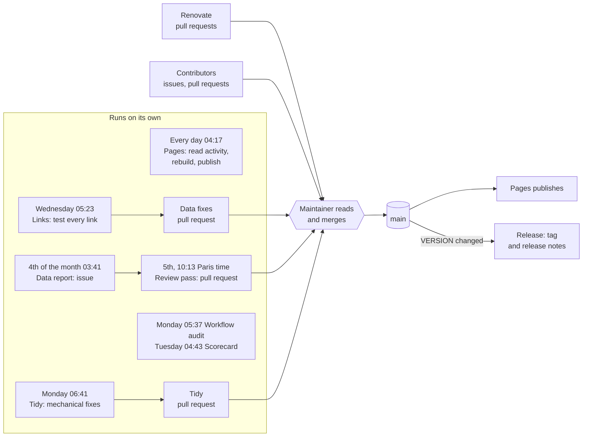

# Maintenance

Who does what, and when. Times are UTC. With no action at all, dates, stars and statuses on the website stay current; corrections and additions wait in their pull request.

## At a glance

## Scheduled runs

| Workflow | When (UTC) | Does | Writes |
|---|---|---|---|
| **Pages** | every day 04:17, every push to `main`, after **Preview** | reads activity, builds and publishes the website with the previews | the website; one file a day on branch `history` |
| **Links** | Wednesdays 05:23 | tests every link, from GitHub then from home and office probes | issue **Broken links** |
| **Data fixes** | when **Links** ends, except a dry run | moved addresses, past event dates | pull request **Data fixes** |
| **Data report** | the 4th of each month, 03:41 | monthly report for the review | issue **Monthly data report** |
| Review pass (language model) | the 5th of each month, 10:13 Paris time | full review of the data | pull request **Monthly review vX.Y** |
| **Workflow audit** | Mondays 05:37 | security audit of the workflows | alerts in the **Security** tab |
| **Scorecard** | Tuesdays 04:43, every push to `main` | score of the repository practices | alerts in the **Security** tab, score at `api.scorecard.dev` |
| **Tidy** | Mondays 06:41 | fixes that need no judgement: unused Python imports, lossless compression of the PNG files of `media/` (README images excepted) | pull request **Tidy**, only when a file changed |

Started by hand (**Run workflow**): **Pages**, **Links** (with *dry run*), **Data fixes**, **Data report**, **Render**, **Tidy**, **Release** (notes of the releases).

## On each pull request

| Check | When | What it tells |
|---|---|---|
| **Check** (required) | every pull request, every push to `main` | data valid, generated files up to date, tests, licences, mechanical guards (`scripts/hygiene.py`) |
| **Render** | when the website, its data or its checks change | the website drawn in a real browser, without defect |
| **Preview** | when the website changes, for a branch of this repository opened by a person | a link to the website of the branch, in a comment |
| **Workflow audit** | when a workflow changes | the workflows are safe |
| **Release** | when `VERSION` or `CHANGELOG.md` changes on `main` | tag `vX.Y` and the GitHub release; notes of earlier releases set again from `CHANGELOG.md` |

## Maintainer's tasks

The maintainer's working notes (state, decisions, open items, briefs) are in `dev/`, in French; `CLAUDE.md` says how they are kept.

| Task | When | If not done |
|---|---|---|
| Accept **Data fixes** | Wednesdays, after **Links** | old addresses and past dates stay; the next run proposes them again |
| Accept **Tidy** | Mondays, when it opens | unused imports and heavy images stay; the next run proposes them again |
| Read **Broken links** | Wednesdays, when the issue is open | broken links stay until the monthly review |
| Accept **Monthly review vX.Y** | after the 5th | corrections and additions wait; merge or close it before the next 5th |
| Keep the review's instructions up to date | when a rule of the data changes | the review writes entries the build refuses |
| Accept Renovate's pull requests | when one opens | tools fall behind, security fixes included |
| Handle security alerts | when GitHub sends one | the flaw stays open |
| Answer contributors | when an issue or a pull request opens | the suggestion waits |
| Renew the key of **Data fixes** | when the workflow warns | its checks wait for **Approve and run workflows** |
| Watch the scheduled runs | after a day without **Pages**, a Wednesday without **Links**, a 4th without **Data report** | dates stop moving, reports are not written |

How, task by task:
- **Data fixes**: read each line; a line in bold says *other site, check the owner* (the address moved to another site); then squash and merge.
- **Broken links**: open in a browser each link of *Broken*, *They answer, but the page is dead* and *Failed twice in a row*; fix or remove the entry by a pull request, or leave it to the review. The folded lists need nothing.
- **Monthly review**: read its summary, the guard line first, then squash and merge.
- **Review instructions**: they live in the scheduled task of the review pass, outside this repository; replace them with the text written for the change.
- **Renovate**: squash and merge when **Check** passes. For MiniSearch, a font or terser, first run `npm ci --ignore-scripts && python3 scripts/vendor.py && python3 scripts/build.py` on its branch and commit the result (the pull request says so).
- **Security alerts** (**Security** tab, `SECURITY.md`): fix by a pull request, or dismiss a code scanning alert with its reason; for a secret, revoke it at its service first; only the maintainer dismisses a secret scanning alert.
- **Contributors**: before merging, add the French texts, `VERSION`, the `CHANGELOG.md` entry and the image of the README (`scripts/readme_image.py`); approve the workflows of an outside contributor after reading the change.
- **Key of Data fixes**: generate a new private key for its GitHub App and store it as the secret `DATA_FIXES_APP_KEY`.
- **Globalping token** (secret `GLOBALPING_TOKEN`, set on 26 Nov 2026): **Links** writes in its log how many tests are left this hour and whether the token was used; a warning means the token is refused: create a new one on [dash.globalping.io](https://dash.globalping.io/) and store it again (**Settings**, **Secrets and variables**, **Actions**).
- **Scheduled runs**: **Actions** tab, filter *Event: schedule*; start a missing one with **Run workflow**. GitHub starts scheduled runs on a best-effort basis, often hours late, and can skip them.

## Workflows in detail

### Pages
- Reads GitHub stars, last pushes and archived flags, YouTube channel feeds, subreddits (public Arctic Shift archive, one at a time: Reddit refuses automated reads) and site feeds (`scripts/refresh.py`).
- After a push, or when started by **Preview**, reuses the measurements of the published website instead of reading again; it reads again only if the website cannot be reached.
- Statuses `active`, `slow` and `inactive` follow the last activity date; past event dates disappear at the next daily run.
- Builds `site/` (`scripts/build.py --site-only`): pages, `details.json` (strengths and weaknesses, read when the browser is idle after the page, so that the search finds them too), feeds of new resources (`feed.xml`, `fr/feed.xml`) and of versions (`changes.xml`).
- Puts under `preview/` the previews of the last successful **Preview** run; runs no branch code; without such a run, or once its artefact is older than 30 days, publishes the website without previews.
- The daily run (or one started by hand without previews) hands the day's measurements to a separate job, the only one allowed to write, which keeps them on the branch `history` (`metrics/YYYY-MM-DD.json`).

### Preview
- Starts when a pull request that changes the website is opened, updated, reopened or closed.
- Files that count as the website: `site-src/`, `scripts/build.py`, `scripts/previews.py`, `media/` (not the image of the README), `data/`, `VERSION`, `CHANGELOG.md`, its own workflow.
- Builds the website of every open pull request of this repository opened by a person: never a fork or a bot; drafts included; 20 at most (`scripts/previews.py`).
- The job can write nowhere. `scripts/previews.py` and `scripts/refresh.py` come from the pull request itself and see the token, read-only; the build of each branch (`scripts/build.py`) runs without it, with the measurements of the published website.
- Each preview, at `preview/<number>/`, carries a banner, a red-tinted sticky header with a red band, a tab title that starts with "Preview #<number>" and `noindex`; a failed build gets an error page.
- Then starts **Pages** and keeps one comment on the pull request with the address. A closed request is no longer listed, so it loses its preview at the next run.
- A preview is served by the same website: anyone can open it, and it shares the browser storage of the published pages (theme, language, new tab). A request opened with the personal token of **Data fixes** counts as a person's.

### Links
- lychee reads `data/`, the README, contributing.md and this file from the machines of GitHub (401, 403, 405 and 429 accepted; loopback addresses skipped).
- Each failure is opened again from 3 Globalping probes on home and office networks (2 in Europe, 1 in North America, else any 3), never from data centres; a redirect is followed for 3 hops at most.
- Broken: fails from every probe that read it (2 at least) and again 90 seconds later. Otherwise it only blocks GitHub. A secure connection refused everywhere is listed apart.
- Dead pages that answer 200 (parked or expired domain, unrelated content, closure notice) are looked for at the address of every open entry.
- Platforms are left out of that search: YouTube, Reddit, GitHub, Facebook, Instagram, Discord, X, TikTok, Flickr, Patreon, Twitch.
- `scripts/links_issue.py` keeps the issue **Broken links** (label `links`): open when a link is broken, a page is dead, or a link failed twice in a row without a verdict; closed otherwise. If lychee writes no report, the issue is left as it is.
- When the hourly limit of Globalping cuts the list, the links of the previous run go first.
- *Dry run* writes the issue body in the run summary, changes no issue and does not start **Data fixes**. `python3 scripts/links_issue.py --sample tests/links-sample.json` reads its yardstick again.

### Data fixes
- `scripts/autofix.py` replaces an address only after a permanent redirect (301 or 308) that ends on a 200 without a query, in 5 hops at most, and removes past `next_date` values; `data/journeys.toml` is left out.
- Recreates the branch `auto/data-fixes` from `main` at each run and opens or updates the pull request **Data fixes** (label `automatic`): a commit added by hand on that branch is lost at the next run.
- Opens the pull request with its GitHub App (variable `DATA_FIXES_APP_ID`: the app's client ID; secret `DATA_FIXES_APP_KEY`) or, failing that, a personal token (secret `DATA_FIXES_TOKEN`), so that **Check** and **Render** start on their own.

### Tidy
- `scripts/tidy.py` removes unused Python imports (ruff's safe fix) and compresses the PNG files of `media/` without loss (oxipng, text chunks kept); the README images (`media/site-preview*.png`) are left to the version pull requests.
- Recreates the branch `auto/tidy` from `main` at each run and opens or updates the pull request **Tidy** (label `automatic`) only when a file changed: a commit added by hand on that branch is lost at the next run.
- Opens it with the app or token of **Data fixes**, so that its checks start on their own.
- Runs on Python 3.13, the last one pyoxipng ships wheels for: a Renovate pull request that raises the Python of `tidy.yml` breaks the next Monday's run, and is closed until pyoxipng ships wheels for that version.

### Data report
- `scripts/refresh.py --month` reads the activity again and writes the issue **Monthly data report** (label `automatic`), read by the review the next day.

| Section | What it lists |
|---|---|
| Guard line | what the previous report listed and is still there |
| Read failures, archived repositories | sources that could not be read, repositories archived |
| Selection no longer eligible | selected entries without activity for 6 months, archived, not active, or on a weak source |
| Not checked for a year | entries to read again |
| Coverage gaps | countries with 3 or more fan communities recognised by LEGO and at most one entry per community |
| Selection check | a selected entry scoring 2 or more below an active one of its group (score out of 7: activity or how recent the check, confidence, sources read) |
| Changes of the month | statuses, archived repositories, entries measured or no longer measured (branch `history`) |
| Links that block GitHub | copied from **Broken links** |
| Reliability, trends | confidence and kinds of sources per category; two windows of 90 days (`scripts/trends.py`) |

- The selection is the rank 1 worldwide of each group.

### Review pass (language model)
- Scheduled task outside this repository; never pushes to `main`.
- Reads every entry at its source and corrects it; adds missing resources; finds feeds (`scripts/discover_feeds.py`); reads `brands`, `funding`, `makers` and `audience` again at the source; reviews the ranks of each group and the needs of "Where to start"; writes the French texts of entries proposed in English.
- Recounts the fan communities per country from the LEGO Fan CoLab directory; renews population figures in January.
- Raises the minor version, writes the `CHANGELOG.md` entry from `scripts/changelog.py`, takes the image of the README again, and opens **Monthly review vX.Y**.

### Check
- Validates `data/`; checks that `README.md`, `full-list.md` and the category list of the **Add a resource** form are up to date, and that `CHANGELOG.md` has a section for `VERSION`, each entry at most 550 characters (the details belong to the pull request).
- Checks that this file names every workflow and schedule, and that `data/SCHEMA.md` names every controlled word and backend file.
- Warns, without failing, when the image of the README shows another version.
- `reuse lint` (`REUSE.toml`, `LICENSES/`); unit tests (`tests/`: data, pages, about pages, links issue, monthly report, previews); awesome-lint as locked in `package-lock.json`; MiniSearch and the fonts of the Brick Vault match their locked packages (`scripts/vendor.py`).
- Mechanical guards (`scripts/hygiene.py`, after the build): ruff and vulture on the Python code (unused imports, functions, classes and variables, unreachable code; `tests/vulture-allow.py` names what the standard library calls); strings of `site-src/strings.json` and fields of the page data that nothing reads; every job with `timeout-minutes` and every pull-request workflow with a `concurrency` group; weight budgets of the pages (per resource, so that the directory may grow) and of the about pages in `tests/budgets.json`, raised only with a reason in the pull request.
- Runs on the latest Python release only; a new push to a pull request cancels its previous run (every push to `main` keeps its own).

### Render
- `scripts/check_site.py` opens every view (directory as cards and table, brand mode of an alternative brand and of LEGO, observatory, about page, Brick Vault) in English and French at 1440, 1024, 768, 390 and 320 px, light theme; dark theme at 1440 and 390 px.
- Fails on:
  - a sideways scroll, an element out of its box;
  - a phone, email, date, tag or button label split over two lines, a word split inside itself;
  - overlapping chart labels, a frame inherited by an inner list;
  - a script or security policy error;
  - a word of the strengths or weaknesses that the search does not find;
  - on phones, a search bar on more than two lines, a field under 16 px (a phone zooms into it);
  - a CSS selector that matches nothing in any view and state checked (except data-only runs), unless `tests/css-states.txt` names the state it is for.
- Accessibility (axe-core, WCAG 2.2 A and AA) at 1440 and 390 px, both themes: a guard, not a conformance target (the 13 px studs of the map are accepted).
- First checks itself on `tests/render-fixture.html` and `tests/phone-fixture.html`, where the defects of each check are planted beside sound cases. On failure, the findings are kept 7 days as the artefact `render-findings`.
- A pull request that changes only data and the files generated from it gets a lighter pass (`--data-only`: 1440, 390 and 320 px, light theme, no accessibility; about a fifth of the time of the full checks, measured locally). A push to `main` gets every check.
- Its jobs (layout and accessibility of each width, theme and language, search) are shared between browsers, one per processor, 8 at most (`--jobs`): 1.5 to 2.5 minutes for the run (2 min 18 s measured on 26 Nov 2026 with the about pages).
- The font packages Playwright installs are kept between runs (`actions/cache`, saved from `main` only, a new key each week, with each change of `tests/requirements.txt` and with each runner image): the Ubuntu mirror sometimes served them at 60 kB/s.
- Not a required check (a path filter would leave it pending): its result is read before merging.

### Release
- Tags `vX.Y` and publishes the GitHub release with its `CHANGELOG.md` section (`scripts/release_notes.py`); fails if the section is missing, does nothing if the version exists. Releases are immutable: read the entry before merging.
- At each change of `CHANGELOG.md` on `main` (or by hand), the notes of every earlier release are set again to its section when they differ: an entry shortened in the changelog is shortened in its release too.

### Workflow audit and Scorecard
- **Workflow audit**: zizmor reads `.github/workflows/` (dangerous triggers, injections, excessive permissions, unpinned or vulnerable actions) on every pull request or push to `main` that changes a workflow, and Mondays.
- **Scorecard**: OpenSSF Scorecard scores the rules of `main`, pinned dependencies, token permissions, dangerous workflows and security policy; a change of the ruleset is scored at the next run.

### Renovate
- Proposes the latest version of the workflows' actions (grouped in one pull request), Python, Node, the tools of the checks, MiniSearch, terser and the fonts, 3 days after it is published, at once for a security fix.
- The Python tools of the checks are locked with their hashes (`tests/*.in`, compiled by `uv pip compile --generate-hashes` into `tests/*.txt`, installed with `--require-hashes --only-binary=:all:`, so no package runs a build script at installation); Renovate compiles the lock again.

## The website

- Generated, never edited by hand: `README.md`, `full-list.md`, the category list of `.github/ISSUE_TEMPLATE/add-resource.yml` and `site/` (not kept in git), all from `data/` by `scripts/build.py`.
- `data/backend/` holds figures used by the website but listed nowhere as entries (fan communities per country, population), each with its source and date. `data/metrics.json` is a local cache of the last reading.
- The website calls no outside service: the page reads only its own `details.json` (`connect-src 'self'` in `scripts/build.py`).
- Every page shares the header (`site-src/header.html`, `header.js`) and the footer (`site-src/footer.html`).
- About pages (`site-src/about.html`, texts in `about.json`, styles in `about.css`; built as `site/about/` and `site/fr/about/`): what the directory is, how it is made, why a selection, how to take part. Their figures come from the data; their texts restate this file and contributing.md in plain words, so a change of the schedule, the method or the criteria goes into `site-src/about.json` in the same pull request.
- The Brick Vault (`site-src/vault.html`, built as `site/vault/`): an English-only easter egg opened by the Konami code from any page, with its own fonts (`media/fonts/`, SIL Open Font License) and security policy. Hints: arrows in the footer, a comment and a console message, a search suggestion, the logo hopping as the code is typed.

## Versions

- Minor (`4.1`) for every merge that changes content or the website; major (`5.0`) for a change of structure or data format; none for activity data, automation or the README alone.
- The number lives in `VERSION` and `CHANGELOG.md`; **Release** tags it at the merge.
- A pull request that raises `VERSION` takes the image of the README again: `python3 scripts/build.py --site-only && python3 scripts/readme_image.py`.
