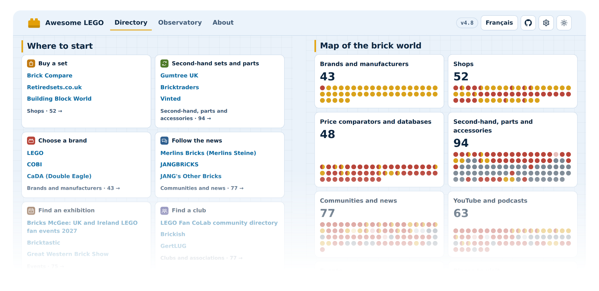

# Awesome LEGO 

> Interlocking plastic construction bricks, from the official LEGO system to compatible brands.

**[Explore the website: every resource, with search, filters and a map](https://actarus314.github.io/awesome-lego/)** · [French version of the website](https://actarus314.github.io/awesome-lego/fr/) · [Feed of new resources (RSS)](https://actarus314.github.io/awesome-lego/feed.xml)

Only the best of each group is listed here. The [full list](full-list.md) has every resource, including inactive and dead ones.

## Contents

- [Brands and manufacturers](#brands-and-manufacturers)
  - [Official LEGO](#official-lego)
  - [European and American alternatives](#european-and-american-alternatives)
  - [Chinese alternatives](#chinese-alternatives)
  - [Brick manufacturers and suppliers](#brick-manufacturers-and-suppliers)
- [Shops](#shops)
  - [Official LEGO](#official-lego-1)
  - [Alternative brands](#alternative-brands)
  - [General retailers](#general-retailers)
- [Price comparators and databases](#price-comparators-and-databases)
  - [Price comparators](#price-comparators)
  - [Set and parts databases](#set-and-parts-databases)
  - [Value and investment tracking](#value-and-investment-tracking)
- [Second-hand, parts and accessories](#second-hand-parts-and-accessories)
  - [Marketplaces and classified ads](#marketplaces-and-classified-ads)
  - [Second-hand and refurbished shops](#second-hand-and-refurbished-shops)
  - [Parts, custom builds and instructions](#parts-custom-builds-and-instructions)
  - [Services and accessories (lighting, display, sorting, data)](#services-and-accessories-lighting-display-sorting-data)
  - [Custom minifigures and accessories](#custom-minifigures-and-accessories)
  - [Decals and stickers](#decals-and-stickers)
  - [Motors, controllers and track](#motors-controllers-and-track)
- [Communities and news](#communities-and-news)
  - [News and reviews](#news-and-reviews)
  - [Forums and chat](#forums-and-chat)
  - [Wikis](#wikis)
  - [Deals](#deals)
- [YouTube and podcasts](#youtube-and-podcasts)
  - [Official LEGO reviews](#official-lego-reviews)
  - [Alternative brand reviews](#alternative-brand-reviews)
  - [Building and custom builds](#building-and-custom-builds)
  - [News and community](#news-and-community)
  - [Podcasts](#podcasts)
- [Events](#events)
  - [Conventions, fairs and exhibitions](#conventions-fairs-and-exhibitions)
  - [Competitions](#competitions)
  - [Event calendars](#event-calendars)
- [Places to visit](#places-to-visit)
  - [Official LEGO venues and stores](#official-lego-venues-and-stores)
  - [Museums and permanent exhibitions](#museums-and-permanent-exhibitions)
  - [Physical shops (alternative brands and used bricks)](#physical-shops-alternative-brands-and-used-bricks)
- [Clubs and associations](#clubs-and-associations)
  - [National clubs](#national-clubs)
- [Learning](#learning)
  - [Guides and reference](#guides-and-reference)
  - [Compatibility, materials and law](#compatibility-materials-and-law)
  - [History](#history)
  - [Books and magazines](#books-and-magazines)
  - [Artists and designers](#artists-and-designers)
- [Tools and APIs](#tools-and-apis)
  - [Design software](#design-software)
  - [Apps](#apps)
  - [APIs and open data](#apis-and-open-data)
  - [Open-source projects](#open-source-projects)
  - [Programming, control and robotics](#programming-control-and-robotics)
- [Other directories and lists](#other-directories-and-lists)
  - [Site directories and awesome lists](#site-directories-and-awesome-lists)
  - [Channel and podcast lists](#channel-and-podcast-lists)
  - [Brand lists](#brand-lists)

 

## Brands and manufacturers

Official LEGO, European and Chinese alternative brands, toy-industry entrants, brick manufacturers and other building formats, with country and brick maker where established.

### Official LEGO

- [LEGO](https://www.lego.com/fr-fr) - Original maker of the 8 mm stud brick system (Denmark), with an adult range (Icons, Technic, Botanicals, Art) and the largest licence portfolio. Covers official LEGO.

### European and American alternatives

- [BlueBrixx](https://www.bluebrixx.com/fr/) - Architecture, trains, medieval, vehicles and licences (BlueBrixx Pro for adults), by BB Services GmbH. Bricks come from several Chinese manufacturers; design and distribution in Germany. Covers alternative brands.
- [COBI](https://cobi.com/fr-fr) - Compatible bricks, own factory in Mielec, Poland; specialised in historical and military models (tanks, aircraft, ships) and licensed vehicles. Covers alternative brands.
- [Mattel Brick Shop (MEGA)](https://shopping.mattel.com/de-de/collections/bausteine-sets) - Adult line launched in 2025: licensed Hot Wheels cars (Lamborghini, Audi, Honda, Aston Martin), Masters of the Universe, Halo, Xbox. Covers alternative brands.
- [Revell Brick System](https://revell.com/collections/brick-system) - Brick line of the plastic model-kit maker, aimed at adults and launched in 2025 with the submarine from Das Boot (6483 pieces, 1:56). Covers alternative brands.

### Chinese alternatives

- [CaDA (Double Eagle)](https://cadatoys.com/) - Technic-style cars, often motorised or remote-controlled and licensed (Master series at 1:8), plus space and military models. Covers alternative brands.
- [Lumibricks (formerly Funwhole)](https://www.lumibricks.com/) - Complete sets of buildings and scenes with integrated light, in 13 collections including Cyberpunk Neoncity and the Blade Runner 2049 licence; Guangzhou, China. Covers alternative brands.
- [Mould King](https://mouldkingcorp.com/) - Very large motorised Technic models, cranes, vehicles and trains from Shantou, China, at a very low price per piece. Covers alternative brands.
- [Pantasy](https://pantasy.com/) - Modular buildings, retro objects, flowers and licences with printed parts, aimed at adult collectors. Covers alternative brands.

### Brick manufacturers and suppliers

- [GoBricks (Shantou Golds Precision Technology)](https://gobricks.net/) - Regarded as the community reference for alternative bricks, with 327 injection machines and a stated 10 billion pieces per year. Covers alternative brands.

 

## Shops

Online and physical shops selling official LEGO, alternative brick brands and general goods to customers in Europe, with delivery to France noted when established.

### Official LEGO

- [LToys](https://www.ltoys.lu/fr) - Store in Niederanven of LTOYS S.A R.L. (founded 2017); official LEGO range plus COBI, CaDA, Pantasy, Lumibricks, Blokees and die-cast cars. Covers official LEGO and alternative brands.

### Alternative brands

- [Brickeez](https://www.brickeez.com) - New official LEGO, Lumibricks, Pantasy, COBI and CaDA; shop in the Hérault. Covers official LEGO and alternative brands.
- [KBS Shop](https://kbs-shop.com) - Technical and remote-controlled bricks: Mould King, CaDA, Reobrix, Wange, Jie Star, Panlos. Covers alternative brands.

### General retailers

- [Alternate (alternate.fr)](https://www.alternate.fr/Jouets/LEGO) - Large official LEGO range delivered to France, from the electronics seller Alternate GmbH. Covers official LEGO.
- [Joybuy France](https://www.joybuy.fr) - Marketplace and direct sales of the JD.com group, opened in France on 16 March 2026, with LEGO among launch brands. Covers official LEGO.

 

## Price comparators and databases

Sites that compare set prices across shops, catalogue sets and parts, track secondary-market value or gather deals, for official LEGO and alternative brands.

### Price comparators

- [Brick Broker](https://brick-broker.com/) - Official LEGO and about 95 alternative brands in one search, with offers deliverable to France; published by Doux Labs SASU, based in Allonzier-la-Caille. Covers official LEGO and alternative brands.
- [Brickmitri](https://brickmitri.com/comparateur-lego/) - Built from the affiliate feeds of French retailers; no account required. Covers official LEGO.
- [Lakea](https://lakea.net/?lang=fr) - Independent service built on its own price collection for official LEGO, also covering parts, minifigures and display cases. Covers official LEGO.

### Set and parts databases

- [Brickset](https://brickset.com/) - Reference for official LEGO sets since 1997 (minifigures, parts, colours, inventories), with collection tracking, reviews, news and lists of discounts at retailers. Covers official LEGO.
- [Rebrickable](https://rebrickable.com/) - Fan-designed custom builds with instructions, official sets and parts; shows which creations can be built with the parts a user owns. Covers official LEGO.
- [SetDB (Merlins Steine)](https://www.merlinsbricks.com/setdb/) - Independent German brick magazine Merlins Steine (merlinssteine.de, English edition Merlins Bricks): sets of many brands, minifigures and parts, next to reviews, news and a weekly podcast. Covers official LEGO and alternative brands.

### Value and investment tracking

- [BrickEconomy](https://www.brickeconomy.com/) - Machine-learning growth forecasts and secondary-market value estimates for official LEGO sets and minifigures. Covers official LEGO.

 

## Second-hand, parts and accessories

Where to buy used sets and loose parts, find custom builds and instructions, and services such as lighting, display cases and sorting.

### Marketplaces and classified ads

- [BrickLink](https://www.bricklink.com/) - Specialised marketplace for new and used official LEGO sets, parts, minifigures and instructions, with a catalogue and a price guide based on past sales. Covers official LEGO.
- [Leboncoin](https://www.leboncoin.fr/) - French classified ads site: sets, large lots, bulk and family collections, with hand-over in person possible. Covers official LEGO and alternative brands.
- [Vinted](https://www.vinted.fr/) - Peer-to-peer marketplace used for small recent sets, minifigures and quick purchases from a mobile application. Covers official LEGO.

### Second-hand and refurbished shops

- [Brickland](https://brickland.fr/) - French shop of refurbished LEGO: sets checked piece by piece, bulk, minifigures and baseplates; collection buy-back. Covers official LEGO.

### Parts, custom builds and instructions

- [BuyMeBricks](https://buymebricks.com/) - Shop of GoBricks compatible parts run by a French company: part lists imported from Studio, Rebrickable or BrickLink, and custom build kits with PDF instructions. Covers alternative brands.
- [Official LEGO building instructions](https://www.lego.com/fr-fr/service/building-instructions) - Official LEGO page to find the instructions of a set by name or number, and the LEGO Builder application. Covers official LEGO.
- [Open L-Gauge](https://open-l-gauge.eu/) - Community library of free LEGO train model instructions, among them German locomotives (Baureihe 152, 185, 189, Vectron).
- [Pick a Brick (LEGO.com)](https://www.lego.com/fr-fr/pick-and-build/pick-a-brick) - New individual parts sold by LEGO, ordered on the French LEGO.com site. Covers official LEGO.
- [ToyPro](https://www.toypro.com/fr) - Dutch shop of new genuine LEGO parts, minifigures and sets. Covers official LEGO.

### Services and accessories (lighting, display, sorting, data)

- [Bright My Bricks](https://brightmybricks.com/) - Shop of LED light kits, each designed for one LEGO set (570 kits stated), with lighting components, acrylic displays and a kit request form. Covers official LEGO.
- [Lightailing and Briksmax](https://www.lightailing.com/fr) - LED light kits for specific LEGO sets, sold as kits without the set. Covers official LEGO.
- [Stick N' Bricks](https://sticknbricks.com/) - French maker of frames for LEGO minifigures (25x25, 30x40 and 50x50 cm formats), frame backgrounds and custom stickers.
- [Wicked Brick](https://www.wickedbrick.com/) - Made-to-order acrylic display cases and stands for LEGO sets and minifigures, with a European store. Covers official LEGO.

### Custom minifigures and accessories

- [Brick Manufacture](https://brick-manufacture.com/en) - Hamburg workshop, active since 2023, printing and assembling personalised LEGO minifigures and bricks in house; site in four languages with a country selector including France.
- [Minifigs.me](https://minifigs.me/) - British shop of custom minifigures printed onto genuine LEGO parts, with small builds and frames; ships worldwide from the United Kingdom.

### Decals and stickers

- [BrickStickerShop](https://www.brickstickershop.com/) - Dutch shop of replacement and custom vinyl stickers for LEGO sets and builds, vector drawn, with ink calibrated to brick colours; ships worldwide.

### Motors, controllers and track

- [BuWizz](https://buwizz.com/) - Slovenian maker of Bluetooth controllers with a rechargeable battery and of motors for LEGO Technic, System and train models, driven from a phone application.
- [Trixbrix](https://trixbrix.eu/en/) - Polish maker of plastic track compatible with LEGO train track: curves from R24 to R184, many switch types, ballast plates, bridges, UV-printed tiles and automation parts (train detection, motorised points, signals).

 

## Communities and news

Forums, subreddits, wikis, news and review sites, deal communities and chat servers about official LEGO and alternative bricks.

### News and reviews

- [Hoth Bricks](https://www.hothbricks.com/) - Contests, rumours and deals alongside new sets, reviews and sets about to retire. Covers official LEGO.
- [Merlins Bricks (Merlins Steine)](https://www.merlinsbricks.com/) - Independent platform covering all brands (German version merlinssteine.de): SetDB, a database of more than 39000 sets, a reviews archive and a weekly podcast. Covers official LEGO and alternative brands.
- [New Elementary](https://www.newelementary.com/) - Tracking of Pick a Brick prices and new parts in sets, with articles on LEGO parts, sets and building techniques. Covers official LEGO.
- [The Brothers Brick](https://www.brothers-brick.com/) - Describes itself as the world's number one source of LEGO news, reviews and fan creations. Covers official LEGO.

### Forums and chat

- [Eurobricks Forums](https://www.eurobricks.com/forum/) - Sections on custom builds, reviews and marketplace for adult fans of LEGO, plus one on alternative brands. Covers official LEGO and alternative brands.
- [HardWare.fr: compatible bricks topic](https://forum.hardware.fr/hfr/Discussions/Loisirs/briques-construction-compatibles-sujet_119659_1.htm) - Long-running topic on LEGO-compatible brick brands (started 16 December 2021), with an introduction kept up to date on brands, compatibility and after-sales service. Covers alternative brands.
- [TechLug.fr forum](https://www.techlug.fr/Forum/) - LEGO Technic and Mindstorms: news, set discussions, modifications of official sets, custom builds and a section on theory of mechanisms and gearing. Covers official LEGO.

### Wikis

- [Brickipedia](https://en.brickimedia.org/wiki/Main_Page) - Collaborative encyclopedia of official LEGO sets, themes, minifigures and history; founded 29 January 2006. Covers official LEGO.

### Deals

- [Dealabs: LEGO group](https://www.dealabs.com/groupe/lego) - LEGO promotions posted, voted and commented by members, from LEGO.com and French retailers. Covers official LEGO.

 

## YouTube and podcasts

English- and French-language YouTube channels and podcasts: reviews of official LEGO and alternative brands, builds and news.

### Official LEGO reviews

- [Brickmitri (YouTube)](https://www.youtube.com/@brickmitri) - Describes itself as an independent medium; LEGO news and set reviews. Covers official LEGO.
- [JANGBRiCKS](https://www.youtube.com/@JANGBRiCKS) - Run by an adult fan; the channel description states the content is unsponsored and titles carry a #NotAd tag. Covers official LEGO.
- [RacingBrick](https://www.youtube.com/@RacingBrick) - LEGO Technic and vehicle sets in detailed build reviews, with Powered Up tutorials. Covers official LEGO.
- [Tiago Catarino](https://www.youtube.com/@TiagoCatarino) - Former official LEGO designer reviewing sets, with building tips. Covers official LEGO.

### Alternative brand reviews

- [BrickMeet](https://www.youtube.com/@BrickMeet) - Military and vehicle sets in speed-build reviews, mainly Cobi, CaDA, Panlos and Mould King; the author also runs German and English blogs. Covers official LEGO and alternative brands.
- [JANG's Other Bricks](https://www.youtube.com/@JANGsOtherBricks) - Run by the author of JANGBRiCKS; non-sponsored reviews of brick-built construction toys from many brands. Covers official LEGO and alternative brands.
- [The Laser Symphony](https://www.youtube.com/@TheLaserSymphony) - CaDA, Cobi, Pantasy and Lumibricks tested next to official LEGO sets; some videos state that products were supplied. Covers official LEGO and alternative brands.

### Building and custom builds

- [BrickVault](https://www.youtube.com/channel/UCrhb3SP2lZBgguLHIWWuHOQ) - Weekly top-10 selections of LEGO custom builds, and display ideas. Covers official LEGO.

### News and community

- [Beyond the Brick](https://www.youtube.com/@BeyondtheBrick) - Began in November 2011 as an audio-only podcast, as the channel states; it also sells merchandise and covers LEGO news and reveals. Covers official LEGO.

### Podcasts

- [Back 2 Brick LEGO Podcast](https://back2brick.buzzsprout.com/) - Hosted by an adult fan: LEGO news, custom builds and interviews with LEGO designers, with a weekly news recap on Fridays.
- [Briques en Vrac](https://www.vodio.fr/vodiotheque/c/1753/briques-en-vrac-actualites-et-nouveautes-lego/) - LEGO news and new releases. Covers official LEGO.

 

## Events

Conventions, fan exhibitions, artist shows, public competitions and calendars listing brick events by country.

### Conventions, fairs and exhibitions

- [Brick Mania Antwerpen](https://www.belug.be/brickmania/antwerpen/) - Largest LEGO exhibition in Belgium, organised by the Belgian LEGO User Group BeLUG at Antwerp Expo, with layouts, a Great Ball Contraption, workshops and sales. Covers official LEGO.
- [Fana'briques](https://expo.fanabriques.fr/fr/) - Large LEGO exhibition at the Parc des expositions in Colmar, organised by volunteers of the association Fanabriques, with dioramas, mosaics, new and second-hand LEGO shops and artists' stalls. Covers official LEGO.
- [Skærbæk Fan Weekend](https://www.fanweekend.dk/) - International convention of adult fans of LEGO in southern Jutland, 80 km south of Billund, with a public exhibition of custom builds on the Saturday and Sunday. Covers official LEGO.

### Competitions

- [LEGO Ideas challenges](https://ideas.lego.com/challenges) - Official building challenges on the LEGO Ideas platform, with prizes of sets and, for some, a path to an official product. Covers official LEGO.

### Event calendars

- [hothbricks: expositions et événements LEGO](https://www.hothbricks.com/expos/) - Agenda of LEGO exhibitions in France, Belgium and Switzerland, plus international events where LEGO is present. Covers official LEGO.
- [steine-kanal: Veranstaltungskalender](https://www.steine-kanal.de/veranstaltungskalender-2027-alle-lego-fan-veranstaltungen-und-boersen-im-uberblick/) - Yearly calendar of LEGO fan events and trading fairs by month, with a separate section for exhibitions using bricks of other manufacturers; permanent museums are added. Covers official LEGO and alternative brands.

 

## Places to visit

Venues of the brick world that can be visited: official LEGO venues and stores, theme parks, museums and permanent exhibitions, physical shops for alternative brands and used bricks, and cafés with bricks.

### Official LEGO venues and stores

- [LEGO House](https://legohouse.com/en-gb) - Official LEGO experience centre in Billund, Denmark, with four Experience Zones, a historical collection of the LEGO Group and the brick, a LEGO Store and restaurants. Covers official LEGO.
- [LEGO Stores directory](https://www.lego.com/fr-fr/stores) - Official directory of LEGO Stores, with a page per store (address, opening hours, features such as Pick and Build wall, Build a Minifigure, LEGO Insiders). Covers official LEGO.

### Museums and permanent exhibitions

- [Frankensteins Klemmbaustein Museum](https://frankensteins.de/) - Museum in Eckental near Nuremberg showing LEGO and compatible brands (COBI, Mould King, Wange, Cada, Reobrix, Sembo and others), with a large main layout, special exhibitions, a building room, a shop and a café. Opened in October 2021. Covers official LEGO and alternative brands.
- [Museum of Bricks](https://museumofbricks.cz/) - Private LEGO museum with five sites in Czechia (Prague flagship on Národní třída, Kutná Hora, Špindlerův Mlýn, Poděbrady, Hatě near Znojmo), built on the collection of Miloš Křeček. Covers official LEGO.
- [Palais de la Maquette - Musée du Jouet](http://www.palaisdelamaquette.com/) - Toy museum in Valras-Plage (Hérault) with giant animated LEGO and K'NEX models on 200 m²: seaside resort, harbour, medieval town, amusement park. Covers official LEGO.

### Physical shops (alternative brands and used bricks)

- [Time For Bricks](https://www.timeforbricks.fr/) - French shops in Chambéry (since 2023) and Annecy (opened in July 2026) selling about thirty alternative brick brands compatible with standard bricks, with free building tables and a hot drink corner in Annecy. Covers alternative brands.

 

## Clubs and associations

User groups, clubs and associations of LEGO and brick fans, from the LEGO Fan CoLab recognition programme to national and local clubs in Europe.

### National clubs

- [BeLUG](https://www.belug.be/) - Independent of the LEGO Group, for adult builders and collectors; present at fairs in Belgium and abroad and organiser of Brick Mania. Covers official LEGO.
- [Brickish](https://brickish.org/) - Active since 2002 and self-described as the first user group in the United Kingdom; local meet-ups, public shows and a members-only forum for adult fans of LEGO. Covers official LEGO.
- [FreeLUG](https://www.freelug.org/) - Discourse forum, exhibitions and meeting reports; national non-profit association of LEGO fans since 2003. Covers official LEGO.
- [ItLUG](https://itlug.org/) - Founded in 1999 and legally constituted in November 2010; forum, national events and local exhibitions for adult LEGO fans. Covers official LEGO.

 

## Learning

Guides, glossaries, history, compatibility and legal references, education and competitions, books, magazines and recognised brick artists.

### Guides and reference

- [Brick Architect](https://brickarchitect.com/) - Independent site by an architect and author: online LEGO Parts Guide, LEGO Storage Guide, set reviews and monthly news roundups. Covers official LEGO.
- [BrickNerd storage guide](https://bricknerd.com/home/an-opinionated-guide-to-lego-storage-containers-and-cost-5-25-23) - Opinionated guide by an adult fan on sorting loose parts and choosing containers, with a cost comparison of drawer units.

### Compatibility, materials and law

- [Court of Justice judgment C-48/09 P, Lego Juris v OHIM](https://eur-lex.europa.eu/legal-content/EN/TXT/?uri=CELEX%3A62009CJ0048) - Judgment of 14 September 2010: the three-dimensional shape of a LEGO brick cannot be registered as a trade mark, as it consists of a shape necessary to obtain a technical result. Covers official LEGO and alternative brands.

### History

- [LEGO History (official LEGO)](https://www.lego.com/en-us/history) - Official chronology of the LEGO Group from 1890, with articles on the Automatic Binding Bricks (1949), Kiddicraft and the stud and tube principle (patent application of 28 January 1958). Covers official LEGO.

### Books and magazines

- [Blocks magazine](https://blocksmag.com/) - Monthly magazine for adult fans of LEGO, 116 pages, published in the United Kingdom since November 2014 by Silverback Publishing. Covers official LEGO.
- [No Starch Press: LEGO books](https://nostarch.com/catalog/lego) - Publisher catalogue of unofficial LEGO books for builders: technique, Technic, robotics, lighting, trains and art. Covers official LEGO.

### Artists and designers

- [LEGO Certified Professionals (official LEGO list)](https://www.lego.com/en-us/aboutus/lego-certified-professionals) - Official list of adult builders officially recognised by LEGO who run a business with bricks, by region, with the rules on what they may build for clients. Covers official LEGO.
- [Nico71's Technic Creations](https://www.nico71.fr/) - French independent LEGO Technic designer, a mechanical engineer: motorised vehicles and machines, PDF instructions, custom kits, videos explaining design choices and commissioned models for companies.

 

## Tools and APIs

Design software, apps, APIs, open data and open-source projects around LEGO and compatible bricks.

### Design software

- [BrickLink Studio](https://www.bricklink.com/v3/studio/download.page) - 3D editor for LEGO models with BrickLink parts list, instruction editor and photorealistic rendering. Covers official LEGO and alternative brands.
- [LeoCAD](https://www.leocad.org/) - Open-source program to build virtual LEGO models on the LDraw library, for Windows, macOS and Linux. Covers official LEGO.

### Apps

- [Brick Search](https://bricksearch.app/) - Scans QR codes of collectible minifigures on iOS and Android, with collection tracking, wish list, set archive and price comparison by country. Covers official LEGO.

### APIs and open data

- [BrickLink API](https://www.bricklink.com/v3/api.page) - REST interface to the BrickLink marketplace: catalog, price guide, store inventories, orders, messages, feedback. Covers official LEGO and alternative brands.
- [Brickognize](https://brickognize.com/) - Image search for LEGO parts, minifigures, sets and sticker sheets from a photo; free API without key used by several open-source collection tools. Covers official LEGO.
- [Brickset API v3](https://brickset.com/article/52666/brickset-web-services) - JSON and SOAP interface to the Brickset catalog: sets, extra images, instructions, reviews, member collections (read and write). Covers official LEGO.
- [LDraw open standard and parts library](https://www.ldraw.org/) - Digital LEGO model format and official parts library, open standard underlying LeoCAD, LDView, LPub3D and Studio export. Covers official LEGO.
- [Rebrickable API v3](https://rebrickable.com/api/) - REST interface to the official LEGO catalog (sets, parts, minifigures, themes, colours) and to Rebrickable user collections. Covers official LEGO.

### Open-source projects

- [BrickStore](https://github.com/rgriebl/brickstore) - Offline BrickLink inventory management tool for Windows, macOS, Linux, iOS and Android. Covers official LEGO and alternative brands.

### Programming, control and robotics

- [Pybricks](https://pybricks.com/) - Python and block coding for LEGO smart hubs (Technic, City, BOOST, MINDSTORMS, SPIKE); programs are stored on the hub and run without a phone, with a web editor and a reference manual. Covers official LEGO.

 

## Other directories and lists

Existing directories, awesome lists and lists of channels and brands about LEGO and compatible bricks.

### Site directories and awesome lists

- [awesome-lego (ad-si)](https://github.com/ad-si/awesome-lego) - LEGO software, archives, libraries, marketplaces, channels, books, blogs and games, curated by the community. Covers official LEGO.
- [Deparkatre clubs and associations directory](https://deparkatre.fr/associations) - LEGO user groups, clubs and online communities, national, regional and local, in France, Europe and elsewhere. Covers official LEGO.
- [LEGO Fan CoLab community directory](https://fancolab.lego.com/communities/) - Fan communities recognised by LEGO, French associations among them. Covers official LEGO.

### Channel and podcast lists

- [BrickTubed channel directory](https://bricktubed.com/channels/) - Subscribers, views, video count, country, last video and active status for each LEGO YouTube channel; a podcast page also exists. Covers official LEGO and alternative brands.
- [Deparkatre LEGO influencer directory](https://deparkatre.fr/influenceurs) - Creators with an interactive map: LEGO YouTube channels, Instagram accounts, blogs and others. Covers official LEGO and alternative brands.

### Brand lists

- [Liste von Klemmbausteinherstellern (German Wikipedia)](https://de.wikipedia.org/wiki/Liste_von_Klemmbausteinherstellern) - Table of LEGO-compatible brick manufacturers with set maker, brick maker, stud pitch and remarks. Covers official LEGO and alternative brands.
- [other-bricks.com brands](https://other-bricks.com/en/brands/) - Pages comparing building block brands by origin, quality and collection size, with set counts. Covers alternative brands.

## Contributing

Additions and corrections are welcome: read [contributing.md](contributing.md). Entries live in [`data/`](data/); this file is generated from them.
