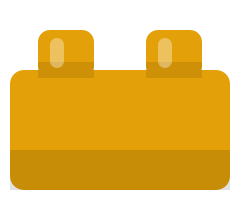

# Awesome LEGO 

> Interlocking plastic construction bricks, from the official LEGO system to compatible brands.

**[Explore the website: every resource, with search, filters and a map](https://actarus314.github.io/awesome-lego/)** · [French version of the website](https://actarus314.github.io/awesome-lego/fr/) · [Feed of new resources (RSS)](https://actarus314.github.io/awesome-lego/feed.xml)

Only the best of each group is listed here. The [full list](full-list.md) has every resource, including inactive and dead ones.

## Contents

- [Brands and manufacturers](#brands-and-manufacturers)
  - [Official LEGO](#official-lego)
  - [European and American alternatives](#european-and-american-alternatives)
  - [Chinese alternatives](#chinese-alternatives)
  - [Brick manufacturers and suppliers](#brick-manufacturers-and-suppliers)
  - [Other formats](#other-formats)
- [Shops](#shops)
  - [Alternative brands](#alternative-brands)
  - [General retailers](#general-retailers)
- [Price comparators and databases](#price-comparators-and-databases)
  - [Price comparators](#price-comparators)
  - [Set and parts databases](#set-and-parts-databases)
  - [Value and investment tracking](#value-and-investment-tracking)
- [Second-hand, parts and accessories](#second-hand-parts-and-accessories)
  - [Marketplaces and classified ads](#marketplaces-and-classified-ads)
  - [Second-hand and refurbished shops](#second-hand-and-refurbished-shops)
  - [Parts, custom builds and instructions](#parts-custom-builds-and-instructions)
  - [Services and accessories (lighting, display, sorting, data)](#services-and-accessories-lighting-display-sorting-data)
  - [Custom minifigures and accessories](#custom-minifigures-and-accessories)
  - [Decals and stickers](#decals-and-stickers)
  - [Motors, controllers and track](#motors-controllers-and-track)
- [Communities and news](#communities-and-news)
  - [News and reviews](#news-and-reviews)
  - [Forums and chat](#forums-and-chat)
  - [Reddit](#reddit)
  - [Wikis](#wikis)
  - [Deals](#deals)
- [YouTube and podcasts](#youtube-and-podcasts)
  - [Official LEGO reviews](#official-lego-reviews)
  - [Alternative brand reviews](#alternative-brand-reviews)
  - [Building and custom builds](#building-and-custom-builds)
  - [News and community](#news-and-community)
  - [Podcasts](#podcasts)
- [Events](#events)
  - [Conventions, fairs and exhibitions](#conventions-fairs-and-exhibitions)
  - [Competitions](#competitions)
  - [Event calendars](#event-calendars)
- [Places to visit](#places-to-visit)
  - [Official LEGO venues and stores](#official-lego-venues-and-stores)
  - [Theme parks](#theme-parks)
  - [Museums and permanent exhibitions](#museums-and-permanent-exhibitions)
  - [Physical shops (alternative brands and used bricks)](#physical-shops-alternative-brands-and-used-bricks)
  - [Cafés and play spaces](#cafés-and-play-spaces)
- [Clubs and associations](#clubs-and-associations)
  - [National clubs](#national-clubs)
  - [Regional and local clubs](#regional-and-local-clubs)
  - [Clubs for alternative brands](#clubs-for-alternative-brands)
  - [Online clubs](#online-clubs)
- [Learning](#learning)
  - [Guides and reference](#guides-and-reference)
  - [Compatibility, materials and law](#compatibility-materials-and-law)
  - [History](#history)
  - [Education and competitions](#education-and-competitions)
  - [Books and magazines](#books-and-magazines)
  - [Artists and designers](#artists-and-designers)
- [Tools and APIs](#tools-and-apis)
  - [Design software](#design-software)
  - [Apps](#apps)
  - [APIs and open data](#apis-and-open-data)
  - [Open-source projects](#open-source-projects)
  - [Programming, control and robotics](#programming-control-and-robotics)
- [Other directories and lists](#other-directories-and-lists)
  - [Site directories and awesome lists](#site-directories-and-awesome-lists)
  - [Channel and podcast lists](#channel-and-podcast-lists)
  - [Brand lists](#brand-lists)

 

## Brands and manufacturers

Official LEGO, European and Chinese alternative brands, toy-industry entrants, brick manufacturers and other building formats, with country and brick maker where established.

### Official LEGO

- [LEGO](https://www.lego.com/fr-fr) - Original maker of the 8 mm stud brick system (Denmark), with an adult range (Icons, Technic, Botanicals, Art) and the largest licence portfolio. Covers official LEGO.

### European and American alternatives

- [COBI](https://cobi.com/fr-fr) - Compatible bricks, own factory in Mielec, Poland; specialised in historical and military models (tanks, aircraft, ships) and licensed vehicles. Covers alternative brands.

### Chinese alternatives

- [CaDA (Double Eagle)](https://cadatoys.com/) - Technic-style cars, often motorised or remote-controlled and licensed (Master series at 1:8), plus space and military models. Covers alternative brands.

### Brick manufacturers and suppliers

- [GoBricks (Shantou Golds Precision Technology)](https://gobricks.net/) - Regarded as the community reference for alternative bricks, with 327 injection machines and a stated 10 billion pieces per year. Covers alternative brands.

### Other formats

- [nanoblock (Kawada)](https://www.kawada-toys.com/en/brand/nanoblock/) - Micro-blocks whose smallest piece measures 4 mm by 4 mm by 5 mm, on sale since October 2008: animals, landmarks, ships and castles, with an Advanced Hobby series for adults. Covers alternative brands.

 

## Shops

Online and physical shops selling official LEGO, alternative brick brands and general goods to customers in Europe, with delivery to France noted when established.

### Alternative brands

- [KBS Shop](https://kbs-shop.com) - Technical and remote-controlled bricks: Mould King, CaDA, Reobrix, Wange, Jie Star, Panlos. Covers alternative brands.

### General retailers

- [Alternate (alternate.fr)](https://www.alternate.fr/Jouets/LEGO) - Large official LEGO range delivered to France, from the electronics seller Alternate GmbH. Covers official LEGO.

 

## Price comparators and databases

Sites that compare set prices across shops, catalogue sets and parts, track secondary-market value or gather deals, for official LEGO and alternative brands.

### Price comparators

- [Lakea](https://lakea.net/?lang=fr) - Independent service built on its own price collection for official LEGO, also covering parts, minifigures and display cases. Covers official LEGO.

### Set and parts databases

- [Brickset](https://brickset.com/) - Reference for official LEGO sets since 1997 (minifigures, parts, colours, inventories), with collection tracking, reviews, news and lists of discounts at retailers. Covers official LEGO.

### Value and investment tracking

- [BrickEconomy](https://www.brickeconomy.com/) - Machine-learning growth forecasts and secondary-market value estimates for official LEGO sets and minifigures. Covers official LEGO.

 

## Second-hand, parts and accessories

Where to buy used sets and loose parts, find custom builds and instructions, and services such as lighting, display cases and sorting.

### Marketplaces and classified ads

- [BrickLink](https://www.bricklink.com/) - Specialised in new and used official LEGO sets, parts, minifigures and instructions; catalogue and price guide based on past sales. Covers official LEGO.

### Second-hand and refurbished shops

- [Bricks & Minifigs](https://bricksandminifigs.com/) - Franchised stores that buy, sell and trade: Certified Used sets checked complete with figures and instructions, Minifig Maker tables and bulk bricks sold by the cup, trade-ins paid in cash or store credit. Covers official LEGO.

### Parts, custom builds and instructions

- [BuyMeBricks](https://buymebricks.com/) - Studio, Rebrickable or BrickLink part lists imported to order GoBricks compatible parts, and custom build kits with PDF instructions. Covers alternative brands.

### Services and accessories (lighting, display, sorting, data)

- [Bright My Bricks](https://brightmybricks.com/) - LED light kits, each designed for one LEGO set (570 kits stated), with lighting components, acrylic displays and a kit request form. Covers official LEGO.

### Custom minifigures and accessories

- [Hall of Bricks](https://hallofbricks.shop/) - Studio printing in house with UV printers on original LEGO elements, making custom minifigures since 2012; ships worldwide.

### Decals and stickers

- [BrickStickerShop](https://www.brickstickershop.com/) - Replacement and custom vinyl stickers for LEGO sets and builds, vector drawn, with ink calibrated to brick colours; ships worldwide.

### Motors, controllers and track

- [BuWizz](https://buwizz.com/) - Driven from a phone application: Bluetooth controllers with a rechargeable battery and motors for LEGO Technic, System and train models.

 

## Communities and news

Forums, subreddits, wikis, news and review sites, deal communities and chat servers about official LEGO and alternative bricks.

### News and reviews

- [Merlins Bricks (Merlins Steine)](https://www.merlinsbricks.com/) - Independent platform covering all brands (German version merlinssteine.de): SetDB, a database of more than 39000 sets, a reviews archive and a weekly podcast. Covers official LEGO and alternative brands.

### Forums and chat

- [Eurobricks Forums](https://www.eurobricks.com/forum/) - Sections on custom builds, reviews and marketplace for adult fans of LEGO, plus one on alternative brands. Covers official LEGO and alternative brands.

### Reddit

- [r/lego](https://www.reddit.com/r/lego/) - News, photos and discussion on LEGO; sales and trades are sent to other subreddits. Covers official LEGO.

### Wikis

- [Brickipedia](https://en.brickimedia.org/wiki/Main_Page) - Collaborative encyclopedia of official LEGO sets, themes, minifigures and history; founded 29 January 2006. Covers official LEGO.

### Deals

- [Dealabs: LEGO group](https://www.dealabs.com/groupe/lego) - LEGO promotions posted, voted and commented by members, from LEGO.com and French retailers. Covers official LEGO.

 

## YouTube and podcasts

English- and French-language YouTube channels and podcasts: reviews of official LEGO and alternative brands, builds and news.

### Official LEGO reviews

- [JANGBRiCKS](https://www.youtube.com/@JANGBRiCKS) - Run by an adult fan; the channel description states the content is unsponsored and titles carry a #NotAd tag. Covers official LEGO.

### Alternative brand reviews

- [JANG's Other Bricks](https://www.youtube.com/@JANGsOtherBricks) - Run by the author of JANGBRiCKS; non-sponsored reviews of brick-built construction toys from many brands. Covers official LEGO and alternative brands.

### Building and custom builds

- [Brick Experiment Channel](https://www.youtube.com/@BrickExperimentChannel) - Motorised mechanisms and engineering experiments built with LEGO parts and third-party motors and battery boxes; part lists and instructions of some designs are published on a separate blog.

### News and community

- [Beyond the Brick](https://www.youtube.com/@BeyondtheBrick) - Began in November 2011 as an audio-only podcast, as the channel states; it also sells merchandise and covers LEGO news and reveals. Covers official LEGO.

### Podcasts

- [Back 2 Brick LEGO Podcast](https://back2brick.buzzsprout.com/) - Hosted by an adult fan: LEGO news, custom builds and interviews with LEGO designers, with a weekly news recap on Fridays.

 

## Events

Conventions, fan exhibitions, artist shows, public competitions and calendars listing brick events by country.

### Conventions, fairs and exhibitions

- [Skærbæk Fan Weekend](https://www.fanweekend.dk/) - International gathering of adult fans of LEGO in southern Jutland, 80 km south of Billund, with a public exhibition of custom builds on the Saturday and Sunday. Covers official LEGO.

### Competitions

- [LEGO Ideas challenges](https://ideas.lego.com/challenges) - Building challenges on the LEGO Ideas platform, with set prizes and, for some, a path to an official product. Covers official LEGO.

### Event calendars

- [brick.news: events calendar](https://brick.news/calendar) - Worldwide listing of LEGO and brick fan events, conventions, exhibitions, workshops and meetups, with a page per event. Covers official LEGO and alternative brands.

 

## Places to visit

Venues of the brick world that can be visited: official LEGO venues and stores, theme parks, museums and permanent exhibitions, physical shops for alternative brands and used bricks, and cafés with bricks.

### Official LEGO venues and stores

- [LEGO House](https://legohouse.com/en-gb) - Four Experience Zones, a historical collection on the LEGO Group and the brick, a LEGO Store and restaurants. Covers official LEGO.

### Theme parks

- [LEGOLAND Billund Resort](https://www.legoland.dk/) - The original LEGOLAND, opened in 1968 next to LEGO House in Billund. Covers official LEGO.

### Museums and permanent exhibitions

- [Museum of Bricks](https://museumofbricks.cz/) - Built on the collection of Miloš Křeček, with 5 sites: Prague flagship on Národní třída, Kutná Hora, Špindlerův Mlýn, Poděbrady, Hatě near Znojmo. Covers official LEGO.

### Physical shops (alternative brands and used bricks)

- [Time For Bricks](https://www.timeforbricks.fr/) - About thirty brands of alternative bricks compatible with standard bricks, sold in Chambéry (since 2023) and Annecy (opened in July 2026), with free building tables and a hot drink corner in Annecy. Covers alternative brands.

### Cafés and play spaces

- [Brick Bank Café](https://www.brickbankcafe.org/) - LEGO sets or trays of loose bricks hired by the half hour or hour and built at the table, in a former bank, opened in June 2025 in Bingley (West Yorkshire). Covers official LEGO.

 

## Clubs and associations

User groups, clubs and associations of LEGO and brick fans, from the LEGO Fan CoLab recognition programme to national and local clubs in Europe.

### National clubs

- [Brickish](https://brickish.org/) - Active since 2002 and self-described as the first user group in the United Kingdom; local meet-ups, public shows and a members-only forum for adult fans of LEGO. Covers official LEGO.

### Regional and local clubs

- [Stein Hanse e.V.](https://steinhanse.eu/) - More than 500 members across northern Germany, in regional sections, with its own yearly exhibition in Kaltenkirchen (3407 visitors on 11 and 12 April 2026) and trips such as a Baltic Sea cruise. Covers official LEGO.

### Clubs for alternative brands

- [Der helfende Stein](https://derhelfendestein.at/) - Supports children's homes and social facilities with donations in kind; club evenings, a members' forum and a Klemmbaustein Tour exhibition; non-profit association for fans of building bricks of all brands. Covers official LEGO and alternative brands.

### Online clubs

- [BioniLUG](https://bionilug.com/) - Member spotlights and displays at fan conventions for fans of Bionicle and Constraction; user group recognised by the LEGO Group. Covers official LEGO.

 

## Learning

Guides, glossaries, history, compatibility and legal references, education and competitions, books, magazines and recognised brick artists.

### Guides and reference

- [Brick Architect](https://brickarchitect.com/) - By an independent architect and author: the online LEGO Parts Guide and LEGO Storage Guide, set reviews and monthly news roundups. Covers official LEGO.

### Compatibility, materials and law

- [Court of Justice judgment C-48/09 P, Lego Juris v OHIM](https://eur-lex.europa.eu/legal-content/EN/TXT/?uri=CELEX%3A62009CJ0048) - Judgment of 14 September 2010: the three-dimensional shape of a LEGO brick cannot be registered as a trade mark, as it consists of a shape necessary to obtain a technical result. Covers official LEGO and alternative brands.

### History

- [LEGO History (official LEGO)](https://www.lego.com/en-us/history) - Official chronology of the LEGO Group from 1890, with articles on the Automatic Binding Bricks (1949), Kiddicraft and the stud and tube principle (patent application of 28 January 1958). Covers official LEGO.

### Education and competitions

- [FIRST LEGO League (global)](https://firstlegoleague.org/) - The 2026-2027 BIOGLOW season is the last under this name and ends the partnership between FIRST and LEGO Education, which will launch its own season in 2027-2028. Covers official LEGO.

### Books and magazines

- [Blocks magazine](https://blocksmag.com/) - Monthly, 116 pages, for adult fans of LEGO, published in the United Kingdom since November 2014 by Silverback Publishing. Covers official LEGO.

### Artists and designers

- [LEGO Certified Professionals (official LEGO list)](https://www.lego.com/en-us/aboutus/lego-certified-professionals) - Adult builders officially recognised by LEGO who run a business with bricks, listed by region, with the rules on what they may build for clients. Covers official LEGO.

 

## Tools and APIs

Design software, apps, APIs, open data and open-source projects around LEGO and compatible bricks.

### Design software

- [BrickLink Studio](https://www.bricklink.com/v3/studio/download.page) - 3D editor for LEGO models with BrickLink parts list, instruction editor and photorealistic rendering. Covers official LEGO and alternative brands.

### Apps

- [LEGO Builder](https://www.lego.com/en-us/builder-app) - Interactive 3D building instructions with zoom, rotation and shared building, plus a collection of past instructions; official LEGO app. Covers official LEGO.

### APIs and open data

- [Rebrickable API v3](https://rebrickable.com/api/) - REST interface to the official LEGO catalog (sets, parts, minifigures, themes, colours) and to Rebrickable user collections. Covers official LEGO.

### Open-source projects

- [BrickStore](https://github.com/rgriebl/brickstore) - Offline BrickLink inventory management tool for Windows, macOS, Linux, iOS and Android. Covers official LEGO and alternative brands.

### Programming, control and robotics

- [Pybricks](https://pybricks.com/) - Python and block coding for LEGO smart hubs (Technic, City, BOOST, MINDSTORMS, SPIKE); programs are stored on the hub and run without a phone, with a web editor and a reference manual. Covers official LEGO.

 

## Other directories and lists

Existing directories, awesome lists and lists of channels and brands about LEGO and compatible bricks.

### Site directories and awesome lists

- [awesome-lego (ad-si)](https://github.com/ad-si/awesome-lego) - LEGO software, archives, libraries, marketplaces, channels, books, blogs and games, curated by the community. Covers official LEGO.

### Channel and podcast lists

- [BrickTubed channel directory](https://bricktubed.com/channels/) - Subscribers, views, video count, country, last video and active status for each LEGO YouTube channel; a podcast page also exists. Covers official LEGO and alternative brands.

### Brand lists

- [Liste von Klemmbausteinherstellern (German Wikipedia)](https://de.wikipedia.org/wiki/Liste_von_Klemmbausteinherstellern) - Table of LEGO-compatible brick manufacturers with set maker, brick maker, stud pitch and remarks. Covers official LEGO and alternative brands.

## Contributing

Additions and corrections are welcome: read [contributing.md](contributing.md). Entries live in [`data/`](data/); this file is generated from them.
